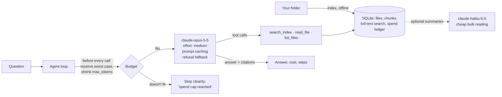

# cost-capped-agent

[](https://github.com/SaurabhTiwari95/cost-capped-agent/actions/workflows/ci.yml)
[](https://github.com/SaurabhTiwari95/cost-capped-agent/actions/workflows/codeql.yml)

A Claude agent that answers questions about a folder of code or documents. It reads the files itself:
it searches an index, reads the lines it needs, and cites them. It **cannot spend more than you
allow**: every API call is checked against a per-question cap and a daily cap before it is sent.



The bundled sample is a small, made-up knowledge base for a wholesaler, "Acme Traders". Point it at
any folder of your own instead.

## Contents

- [What it does](#what-it-does)
- [Prerequisites](#prerequisites)
- [Install](#install)
- [Use it](#use-it)
- [Configuration](#configuration)
- [How the spend cap works](#how-the-spend-cap-works)
- [Run the tests](#run-the-tests)
- [Troubleshooting](#troubleshooting)
- [Security](#security)
- [How it scales](#how-it-scales)
- [Performance](#performance)
- [Design decisions](#design-decisions)
- [Project layout](#project-layout)

## What it does

| Feature | How |
|---|---|
| **Index any folder, offline** | Files are split into line chunks in SQLite full-text search (FTS5). No API call, no cost |
| **Never index secrets** | `.env`, keys and certificates are skipped by name, and any file containing a credential pattern is skipped by content |
| **Incremental** | Unchanged files are skipped by size and modified time without being opened. Changed files are re-hashed |
| **Model routing** | `claude-haiku-5-5` writes one-line file summaries (cheap, effort `low`); `claude-opus-5-5` answers (effort `medium`) |
| **Prompt caching** | The system prompt and the repo map are a byte-stable prefix with a cache breakpoint; the growing tool loop uses automatic caching |
| **Hard spend caps** | Per question (or per summarising run) and per UTC day, enforced before every call, safe across parallel runs |
| **Refusal fallback** | Answer calls send `fallbacks: "default"`: if a safety check declines, Anthropic re-runs the request on its recommended substitute model |
| **Cost report** | Spend per day, model and purpose, with the cache hit rate |

## Prerequisites

| Tool | Version | Needed for | Get it |
|---|---|---|---|
| Python | 3.12 | Everything | <https://www.python.org/downloads/> |
| A Claude API key | your own | `ask` and `index --summarize` (indexing and search work without one) | <https://platform.claude.com/> |
| Docker (optional) | 24+ | Running it as a container | <https://docs.docker.com/get-docker/> |

## Install

### Windows (PowerShell)

```powershell
git clone https://github.com/SaurabhTiwari95/cost-capped-agent.git
cd cost-capped-agent
py -3.12 -m venv .venv
.\.venv\Scripts\Activate.ps1
pip install -r requirements-dev.txt
$env:ANTHROPIC_API_KEY = "<your key>"
```

### macOS / Linux

```bash
git clone https://github.com/SaurabhTiwari95/cost-capped-agent.git
cd cost-capped-agent
python3.12 -m venv .venv
source .venv/bin/activate
pip install -r requirements-dev.txt
export ANTHROPIC_API_KEY="<your key>"
```

The key is read from the environment by the Anthropic SDK; never put it in a file you commit.
Optional settings go in `.env` (copy `.env.example`).

## Use it

### 1. Index a folder (offline, free)

```bash
python -m costagent index sample_corpus
```

```text
indexed 6 new or changed, 0 unchanged, 0 removed; skipped 0 secret-looking and 0 other files
```

Run it again and nothing is re-read:

```text
indexed 0 new or changed, 6 unchanged, 0 removed; skipped 0 secret-looking and 0 other files
```

Optionally add one-line summaries with the cheap model. They're paid for once per file, and the agent
sees them in its repo map:

```bash
python -m costagent index sample_corpus --summarize --max-usd 0.02
```

### 2. Search and browse (offline, free)

```bash
python -m costagent search "late fee"
```

Output (snippets shortened to one line here):

```text
faq.md:1-17   … **I was charged a [late] [fee]. Can it be removed?** A [late] [fee] can be waived once …
handbook/payment-terms.md:1-27   … After 30 days overdue, a [late] [fee] of 1.5% of the outstanding amount is added each month …
handbook/returns.md:1-24   … There is no [fee] for returns under 5,000. …
```

```bash
python -m costagent files handbook/
```

```text
handbook/payment-terms.md (27 lines)
handbook/returns.md (24 lines)
handbook/shipping.md (21 lines)
```

### 3. Ask (calls Claude, costs money, capped)

```bash
python -m costagent ask "When is a late fee charged, and can it be waived?" --max-usd 0.10
```

The answer comes first, with file and line citations, then a status line. This shows the format;
the wording, step count and cost of your run will differ:

```text
A late fee of 1.5% of the outstanding amount is added each month once an invoice is 30 days overdue
(handbook/payment-terms.md:17-21). It can be waived once in any 12 months if the overdue amount is
paid within 7 days of the fee being added (faq.md:12-14).

[done] 3 steps, 3 API calls, 3 tool calls, cost $0.0xxx (cap $0.1000)
```

`--json` prints everything: the answer, why it stopped, steps, every tool call, and tokens by model.

| `stopped` | Meaning |
|---|---|
| `done` | Answered |
| `budget` | The next call wouldn't fit under the run or day cap; the agent stopped cleanly |
| `max_steps` | Hit `AGENT_MAX_STEPS` tool rounds |
| `output_limit` | The answer was cut at `max_tokens` (often because little budget was left) |
| `refused` | Declined by safety checks, even after the fallback |
| `api_error` / `client_error` | The API returned an error, or the client couldn't send (for example, no API key) |

### 4. See what you've spent

```bash
python -m costagent cost-report --days 7
```

Shows one row per day, model and purpose (`answer` or `summary`), with tokens, cache reads, cache hit
rate and cost, then today's total against the daily cap.

### Docker

```bash
docker build -t cost-capped-agent .
docker run --rm -v agentdata:/data --read-only cost-capped-agent index sample_corpus
docker run --rm -v agentdata:/data --read-only -e ANTHROPIC_API_KEY cost-capped-agent ask "What are the payment terms?"
```

To index your own folder, mount it read-only, for example `-v "$PWD/docs:/srv/mydocs:ro"`, then
`index mydocs`.

## Configuration

Environment variables (or `.env`), all optional:

| Variable | Purpose | Default |
|---|---|---|
| `ANTHROPIC_API_KEY` | Your Claude API key (read by the SDK; shell only, not `.env`) | — |
| `AGENT_ANSWER_MODEL` / `AGENT_ANSWER_EFFORT` | Model and effort for answers | `claude-opus-5-5` / `medium` |
| `AGENT_SUMMARY_MODEL` / `AGENT_SUMMARY_EFFORT` | Model and effort for summaries | `claude-haiku-5-5` / `low` |
| `AGENT_RUN_CAP_USD` | Cap per question or per `--summarize` run (`--max-usd` overrides) | `0.25` |
| `AGENT_DAY_CAP_USD` | Cap per UTC day, across all runs and processes | `2.00` |
| `AGENT_MAX_STEPS` | Most tool rounds per question | `10` |
| `AGENT_MAX_OUTPUT_TOKENS` / `AGENT_MIN_OUTPUT_TOKENS` | Ceiling per call / smallest call worth making | `8000` / `512` |
| `AGENT_SUMMARY_CONCURRENCY` | Summaries in flight at once | `4` |
| `AGENT_DB_PATH` | SQLite file for the index and the ledger | `data/agent.db` |
| `AGENT_MAX_FILE_BYTES` / `AGENT_CHUNK_LINES` | Largest file indexed / lines per chunk | `200000` / `60` |
| `AGENT_REPO_MAP_MAX_FILES` | Files listed in the cached repo map | `400` |
| `AGENT_REQUEST_TIMEOUT_SECONDS` / `AGENT_MAX_RETRIES` | Anthropic client settings | `120` / `2` |

Prices live in `costagent/pricing.py` (USD per million tokens, from Anthropic's published list as of
2026-10-06). Check the [pricing page](https://platform.claude.com/docs/en/about-claude/pricing)
and update them if they change. Unknown models are priced at the most expensive known rates.

## How the spend cap works

Before **every** API call:

1. **Estimate the input**, deliberately high (3 characters per token; real text averages nearer 4).
2. **Price the worst case**: every input token at the cache-write rate, at the highest rates the call
   could be billed at. For Opus answers that includes the fallback models, which cost more per token.
3. **Shrink `max_tokens`** to what still fits under `min(run cap left, day cap left)`. Thinking tokens
   count as output, so `max_tokens` bounds them too. If fewer than `AGENT_MIN_OUTPUT_TOKENS` fit,
   **stop** without calling.
4. **Reserve** that worst case in the ledger, in one SQLite `BEGIN IMMEDIATE` transaction that re-checks
   the day's total. Two processes can't both take the last of the day's budget.
5. After the call, **replace the reservation with the real cost** from `usage` (input, cache writes,
   cache reads and output, each at its own rate, at the rates of the model that actually served it).

If a call fails with an HTTP error, the reservation is released (not billed). If it times out or the
connection drops, the reserved worst case is kept as spent, because it may have been billed. If the
process is killed mid-call, the reservation stays counted until the end of the UTC day, which is
safe and over-counts. The cap holds up to the accuracy of the input estimate, which errs high on
purpose.

## Run the tests

```bash
pytest
```

```text
64 passed ... TOTAL ... 97%
```

The tests never call the real API. A scripted fake client records exactly what would have been sent,
so the tests check:

- the model, effort, fallback, caching and tool settings of every request
- the tool loop
- caps across steps, runs, days and parallel runs
- settlement from real usage
- refusals, timeouts and missing credentials

Lint, audit and the pre-publish scan:

```bash
ruff check . && ruff format --check .
pip-audit -r requirements-dev.txt
python scripts/prepublish_check.py
```

A **live smoke test** (`.github/workflows/live-smoke.yml`) calls the real API. It never runs on push:
start it by hand from the Actions tab after adding an `ANTHROPIC_API_KEY` repository secret. It's
capped at $0.20 for the day.

## Troubleshooting

| Problem | Fix |
|---|---|
| `Couldn't call Claude: Could not resolve authentication method` | Set `ANTHROPIC_API_KEY` in this shell (see Install). Nothing was sent or charged |
| `The index is empty` | Run `python -m costagent index <folder>` first |
| `[budget]` right away | Today's spend (`cost-report`) plus this call's worst case exceeds a cap. Raise `--max-usd` or `AGENT_DAY_CAP_USD`, or wait for the next UTC day |
| `[output_limit]` | The answer was cut short, usually because little budget was left. Raise the cap |
| A file you expected isn't indexed | It's over `AGENT_MAX_FILE_BYTES`, not a known text type, under a skipped folder (`.git`, `node_modules`, `data`, …), or looked like it held a secret |
| An edited file isn't re-indexed | Files are compared by size and modified time; if a tool kept both, delete `data/agent.db` and index again |
| `cache hit %` stays at 0 | Normal for a single question; it rises once questions repeat within 5 minutes. The cached prefix needs at least 512 tokens |
| `Activate.ps1 cannot be loaded` | `Set-ExecutionPolicy -Scope CurrentUser RemoteSigned` once |

## Security

- The API key is read only by the SDK from the environment. It's never logged or stored.
- Secret-looking files are never indexed, so they can't reach the model.
- The tools read only from the index, never the disk, with bounded line ranges: no path traversal,
  no writes, no shell. Tool arguments are re-validated even though the schemas are strict.
- The system prompt tells the model that file contents are data, not instructions.
- Pinned dependencies (the SDK held at the newest release that's at least two weeks old),
  pip-audit, Dependabot, CodeQL and gitleaks. The container runs as non-root with a read-only
  filesystem. See [SECURITY.md](SECURITY.md).

## How it scales

- **Index size:** SQLite FTS5 handles hundreds of thousands of chunks on a laptop. The repo map is
  capped (`AGENT_REPO_MAP_MAX_FILES`), so the cached prefix doesn't grow with the folder; beyond it,
  the agent uses `list_files` and `search_index`.
- **Re-indexing** reads only files whose size or modified time changed, and re-summarises only
  files whose content changed.
- **Summaries** run concurrently (`AGENT_SUMMARY_CONCURRENCY`) and stop starting new ones the moment
  the cap is reached.
- **Many users:** the ledger's daily cap is already safe across processes on one machine. For a
  shared service (see the companion `agent-console`), move the ledger to PostgreSQL with the same
  reserve-then-settle transaction. For large batch summarising, the Message Batches API halves the
  price in exchange for latency.

| Load | First bottleneck | Fix |
|---|---|---|
| 10× files | First index (file opening dominates; see Performance) | Index once; re-indexing is incremental |
| 10× questions | Input tokens per question | Already cached: keep the prefix stable and questions within the 5-minute cache window |
| 100× users | SQLite's single writer for the ledger | PostgreSQL ledger; one row lock per reservation |

## Performance

Measured on a busy Windows laptop, with no API calls, on 2,000 generated files (240,000 lines, 4,000
chunks):

| Operation | Time |
|---|---|
| First index | 35 s |
| Re-index, nothing changed | 0.85 s |
| Search, p50 / p95 (100 queries) | 41 ms / 64 ms |
| Build the repo map (400 files) | under 1 ms |

**What profiling showed.** In the first index, 83% of the time was Windows opening newly created
files; SQLite took 0.3 s per 500 files. That's outside the code's control, but it pointed at the
re-index: it was opening and hashing every unchanged file. Comparing size and modified time first
cut re-indexing from 2.47 s to 0.85 s.

**What a question costs** depends on the answer model, how many tool rounds it takes and how much it
reads. `cost-report` shows real numbers from your own runs. The cap guarantees the ceiling.

## Design decisions

- **A manual tool loop, not the SDK's tool runner,** because the cap must be checked and `max_tokens`
  shrunk before *each* request, and the real cost settled after it.
- **Opus 5.5 at effort `medium` for answers, Haiku 5.5 at `low` for summaries.** Effort is the first
  lever after caching. Both are settings, so you can measure before changing them.
- **Thinking is left on** (Opus 5.5 always thinks). Thinking blocks are passed back unchanged in the
  loop, and `max_tokens` bounds their cost.
- **`fallbacks: "default"`** on answer calls: a declined request is retried server-side on the model
  Anthropic recommends for that refusal category. Haiku has no server-side fallback, so summaries
  simply skip a declined file.
- **The cap over-counts on purpose:** high input estimates, worst-case rates, and a timeout counted as
  spent. Being a few cents under is better than being over.
- **SQLite for everything:** a single file you can delete, no server, and FTS5 built in.

## Project layout

```text
costagent/
  agent.py     tool loop, model calls, tools, summaries
  budget.py    reserve → call → settle; BudgetExhausted
  pricing.py   price table, cost of usage, worst case, affordable max_tokens
  indexer.py   scan, secret filter, chunks, FTS search, repo map, concurrent summaries
  store.py     SQLite schema, ledger with atomic reservations, reports
  config.py    settings
  cli.py       index · search · files · ask · cost-report
sample_corpus/ made-up Acme Traders documents
tests/         fake Claude client; agent, budget, pricing, indexer and CLI tests
```

## What's next

- **agent-console:** a web front end with Google sign-in, an ask page, knowledge pages and a cost
  dashboard over this ledger.
- Exact input counting with the token-counting endpoint, as an option, to tighten the cap.
- Summaries through the Message Batches API at half price.
- An eval set of questions with known answers, to measure quality before changing models or effort.

---

AI-assisted (Claude Code); design and review by me.

Licence: [MIT](LICENSE). Security: [SECURITY.md](SECURITY.md).
